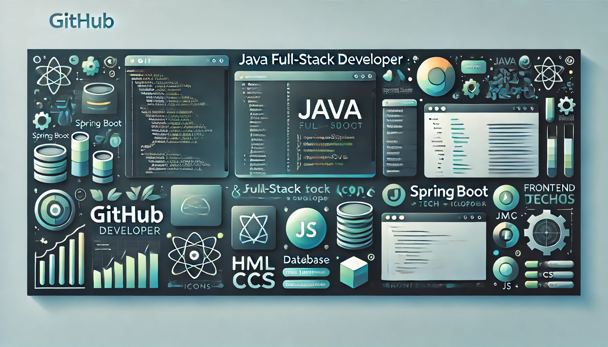
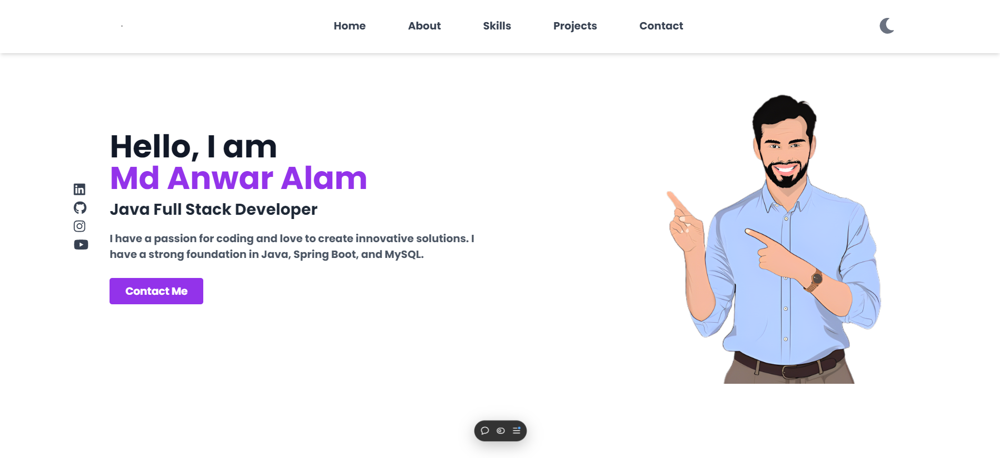
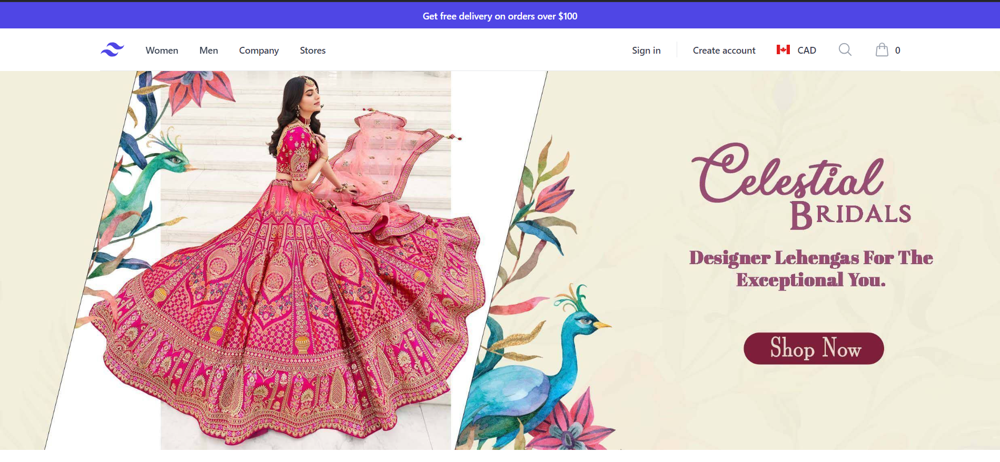


 <h1 align="center">Hi 👋, I'm Md Anwar Alam</h1>
<h3 align="center">Aspiring Java Developer | Full Stack | Spring Boot | SQL | Web Development</h3>

  

- 🔭 I’m currently working on **AI Code reviewer and StreamSphare Microservice Application**
- 🌱 I’m currently learning **Spring Security and Microservices**  
- 💬 Ask me about **Java, Spring Boot, and MySQL**  
- 📫 How to reach me **mdanwar40212@gmail.com**  
- ⚡ Fun fact: **I love debugging and solving real-world problems with code!**  

---

<h3 align="left">Connect with me:</h3>

  
  
  
  

   

---

<h3 align="left">Languages and Tools:</h3>

  
  
  
  
  
  
  
  
  
  

---
<h3 align="left">Most Used Languages:</h3>

  

<h3 align="left">GitHub Stats:</h3>

  

  

###
<h2 align="left">⚡Activity Graph:</h2>

## Profile Counter

  

---

<h3 align="left">Top Repositories:</h3>

  
   

 

<!-- 
<h1 align="center">Hi 👋, I'm Md Anwar Alam</h1>
<h3 align="center">Aspiring Java Developer | Spring Boot | SQL | Web Development</h3>

  

- 🔭 I’m currently working on **E-commerce and Hotel Management Systems**  
- 🌱 I’m currently learning **Spring Security and Microservices**  
- 💬 Ask me about **Java, Spring Boot, and MySQL**  
- 📫 How to reach me **programer12345anwar@gmail.com**  
- ⚡ Fun fact: **I love debugging and solving real-world problems with code!**  

---

<h3 align="left">Connect with me:</h3>

---

<h3 align="left">Languages and Tools:</h3>

  
  
  
  
  
  
  
  
  
  

---

<h3 align="left">GitHub Stats:</h3>

  

  

---

<h3 align="left">Top Repositories:</h3>

  

  

 -->

